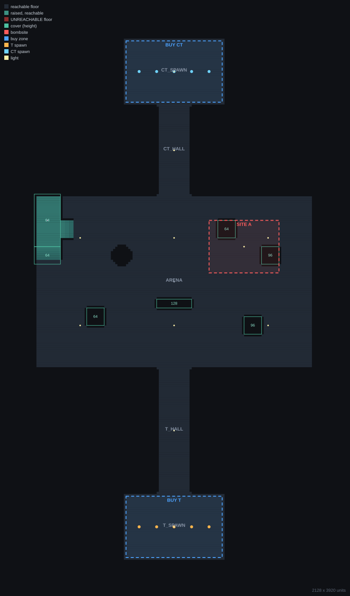

# cs2-mapgen

Build playable **Counter-Strike 2** maps from Python, verify them with real
measurements, and compile them with Valve's own tools, without clicking
brushes in Hammer.

It is designed to be driven by an AI coding assistant (Claude Code, Cursor,
Copilot, and so on): you describe the map you want, the assistant writes it as
code, checks that every room is reachable and the routes are balanced, and
compiles it. You play it and tell it what feels wrong.

<p align="center"></p>

*The included example map, as drawn by `python -m mapgen plan`: reachable
floor, a raised platform with stairs and a ramp, cover with heights, bombsite,
buy zones and spawns.*

## What you get

- **A map generator** that writes CS2's `.vmap` format directly: rooms with
  doorways, cover, pillars, ramps, stairs, spawns, bombsites, buy zones, nav
  seeds, baked lighting and light probes.
- **Checks the compiler doesn't do.** A compile can succeed with a room nobody
  can walk into. `check` floods the real geometry from T spawn and proves every
  spawn, bombsite and room is reachable, so a misaligned doorway shows up
  before you load the game.
- **Route timing.** `routes` measures walking time from each spawn to each
  bombsite, so balance problems (T taking 20 s to reach a site, one site much
  closer than the other) are numbers, not hunches.
- **A plan view** that shows what is actually reachable, with sealed areas in
  red.
- **One-command build**: check, convert, compile, summarise the log.

What it makes is a **blockout**: real scale and layout in dev textures, fully
playable (bombs plant, rounds play, bots navigate). Materials and props are
an art pass you do in Hammer once the layout plays well.

## Requirements

- Windows
- Counter-Strike 2 with the **Counter-Strike 2 Workshop Tools** DLC
  (Steam: Library > Counter-Strike 2 > Properties > DLC)
- Python 3.8+ and numpy: `pip install -r requirements.txt`

## Setup

1. Launch **Counter-Strike 2 Workshop Tools** from Steam and use
   **Create New Addon** (e.g. `my_maps`). Your maps live in this addon.
2. Clone this repo, then check the kit can see everything:

   ```
   pip install -r requirements.txt
   python -m mapgen find
   ```

   It should print your CS2 folder, `found` for both tools, and your addon.
   If CS2 is somewhere unusual, set the `CS2_PATH` environment variable to the
   `Counter-Strike Global Offensive` folder.

## Quick start: the test map

```
python examples/test_map.py                               # writes out/test_map.kv2.vmap
python -m mapgen check  out/test_map.kv2.vmap             # verify
python -m mapgen routes out/test_map.kv2.vmap             # timings
python -m mapgen plan   out/test_map.kv2.vmap             # out/test_map.plan.svg
python -m mapgen build  out/test_map.kv2.vmap --addon my_maps
```

`build` takes about two minutes. Then open `test_map` in Hammer and run it,
or launch CS2 from the Workshop Tools with your addon and type
`map test_map` in the console.

## Using it with an AI assistant

Open this folder in your assistant. `AGENTS.md` and `CLAUDE.md` point it at
[AI_GUIDE.md](AI_GUIDE.md), which holds the rules, scale references, API and
everything learned the hard way about the format. Then just ask, for example:

> Read AI_GUIDE.md. My addon is `my_maps`. Build the example test map and
> compile it so I can check the pipeline works.

> Make a two-site defusal map themed as an abandoned train station. Start with
> a blockout, measure the routes, and compile it for me to playtest.

> Mid feels too long and CTs rotate too easily. Fix both, show me the new
> timings, and rebuild.

A good loop is: the assistant builds and measures, you playtest and describe
how it feels, it adjusts. Answer its questions about theme and feel; it can
measure timings but it cannot see the game.

## Commands

| Command | Does |
|---|---|
| `python -m mapgen find` | locate CS2, its tools and your addons |
| `python -m mapgen check MAP` | layout rules, mesh topology, entities, full walkability |
| `python -m mapgen routes MAP` | walking times between spawns, sites and named points |
| `python -m mapgen plan MAP` | top-down SVG of what is reachable |
| `python -m mapgen info ANY.vmap` | entities and materials of any map, including Hammer-saved ones |
| `python -m mapgen install MAP --addon A` | convert into the addon (never overwrites without `--force`, keeps a backup) |
| `python -m mapgen compile --addon A --map NAME` | full compile with a summarised log |
| `python -m mapgen build MAP --addon A` | check + install + compile |

## Layout

```
mapgen/
  builder.py    rooms, cover, stairs, entities, lighting (the API you use)
  vmap.py       writes Hammer's mesh/entity format
  dmx.py        DMX keyvalues2 text reader/writer
  analysis.py   loading maps, topology checks, walkability, routes
  plan.py       SVG plan renderer
  cs2.py        finds CS2, runs dmxconvert and resourcecompiler
examples/
  test_map.py   small playable defusal map - start here
AI_GUIDE.md     instructions for AI assistants (worth reading yourself)
```

## Good to know

- **Regenerating overwrites Hammer edits.** Treat the Python script as the
  source of truth while you shape the layout; switch to Hammer for the art pass
  once it plays well.
- **The `.vmap` format is undocumented.** It was reverse-engineered from maps
  saved by Hammer (format 40, editor build 9806) and tested against CS2 builds
  from mid-2026. A future CS2 update could change it.
- Maps go into your addon under the name you give them; the kit never
  replaces an existing map without `--force` and always backs it up first.

Not affiliated with or endorsed by Valve. Counter-Strike, Hammer and the
Source 2 tools are Valve's.
